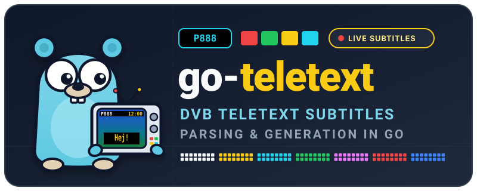

[](https://github.com/Eyevinn/go-teletext/actions/workflows/go.yml)
[](https://coveralls.io/github/Eyevinn/go-teletext?branch=main)
[](https://github.com/Eyevinn/go-teletext/actions/workflows/golangci-lint.yml)
[](https://pkg.go.dev/github.com/Eyevinn/go-teletext)
[](https://github.com/Eyevinn/go-teletext/blob/main/LICENSE)

DVB Teletext parsing and generation in Go, intended to be integrated with MPEG-2 TS streams.

Status: draft. Generation works; parsing is the next step, so that streams can
be checked by round trip and live sources can be monitored.

- `teletext` (this directory): EN 300 706 coding. Hamming 8/4 and 24/18,
  packets (header, rows, X/26, X/28/0, M/29/0), Latin, Cyrillic and Greek
  character sets, a Unicode encoder that falls back to Level 1.5 X/26
  enhancements, a subtitle page composer, and 25 language presets.
- `mpegts`: EN 300 472 data units and PES, and a minimal TS muxer
  (PAT, PMT with teletext descriptor, PCR).
- `cmd/ttx-gen`: a teletext subtitle test source, to a file, stdout or UDP.

## Requirements

Go 1.26 or later.

## Installation / Usage

```sh
go install github.com/Eyevinn/go-teletext/cmd/ttx-gen@latest
```

`ttx-gen` writes one subtitle page per language. Every cue shows a sample
sentence and the UTC time of the PTS of the PES that carries the page
header, so a player or packager can be checked for both character set
handling and timing:

```
Hej på dig, Åsa! Öl är gött.
Svenska 12:00:02.080 (2)
```

```sh
ttx-gen -list                                     # language presets
ttx-gen -o test.ts -duration 60s                  # file, default 9 languages
ttx-gen -udp 127.0.0.1:1234 -duration 0           # live, forever
ttx-gen -live -o - -langs swe,rus > live.ts       # live to stdout
ttx-gen -start 2026-11-20T12:00:00Z -o fixed.ts   # reproducible file
```

Other flags: `-pages`, `-period`, `-cue`, `-level15=false` (Level 1 only),
`-designation auto|x28|m29|none`, `-single-height`, `-hearing-impaired`,
`-pid`, `-pts-offset`. See `ttx-gen -h`.

Heartbeats: by default every 40 ms without other teletext gets a PES with a
time filling header (page mFF), so a live segmenter can release subtitle
segments together with video and audio also when no subtitles are shown.
`-heartbeat` sets the interval (0 = off), `-heartbeat-kind stuffing` sends
stuffing data units instead, and `-cues-on 60s -cues-off 30s` adds periods
without subtitles.

The presets cover the cases decoders handle differently: Level 1 national
sub-sets, Level 1.5 X/26 accents and G2 characters, and X/28/M/29 designation
for Polish, Turkish, Romanian, Croatian, Baltic, Cyrillic and Greek.

Without `-i` the stream has teletext only, with PCR on its own PID. With `-i`,
`ttx-gen` inserts the teletext into an existing transport stream with video and
audio, following its PCR:

```sh
ttx-gen -i in.ts -o out.ts                          # file to file
ttx-gen -i udp://239.0.0.1:1234 -udp 127.0.0.1:5000 # live, multicast in
ttx-gen -i in.ts -o out.ts -muxrate 3000000         # constant 3 Mbit/s output
ttx-gen -live -i in.ts -udp 127.0.0.1:5000          # play a file in real time
```

Teletext packets replace null packets when the input has them (use
`-pts-offset 200ms` when they come in bursts, as with ffmpeg's `-muxrate`), else
they are added. `-muxrate` remuxes to a constant bitrate and restamps the PCR.
Cues show the wall-clock time of their PTS, or the PTS with `-clock pts`.
See the inserter section of [docs/design.md](docs/design.md).

`scripts/all-langs-stream.sh` makes a test stream with video, audio and a page
for every language preset. [docs/test-stream.md](docs/test-stream.md) lists the
text of each page and what to look for in a player.

Using the library:

```go
lang, _ := teletext.LookupLanguage("swe")
enc := teletext.NewEncoder(lang.Charset, true)
addr, _ := teletext.ParsePage("888")
page, err := teletext.ComposePage(addr, enc, []teletext.Line{{Text: "Hej på dig!"}},
	teletext.PageOptions{Level15: true})
// Send page.Header, then at least 20 ms later page.Body, as EN 300 472 data units:
unit := mpegts.DataUnit(mpegts.DataUnitSubtitle, true, 0, page.Header.Bytes())
```

## Documentation

- [docs/research.md](docs/research.md): specifications, teletext levels,
  teletext and EBU STL support in go-astisub and shaka-packager, existing
  generators, Subtitle Edit.
- [docs/design.md](docs/design.md): how pages are encoded and scheduled,
  validation status, limitations.
- [experiments/](experiments/README.md): a separate module that decodes the
  generated stream with go-astisub and reproduces its STL issues.
- `specs/fetch.sh` downloads EN 300 706, EN 300 472, EN 301 775 and EBU Tech 3264.

## Development

```sh
make check   # tidy, vet, lint
make test
make build   # out/ttx-gen
```

`make pre-commit-install` sets up the pre-commit hooks (formatting, lint,
tests, codespell, commitlint).

## Contributing

See [CONTRIBUTING](CONTRIBUTING.md)

## License

This project is licensed under the MIT License, see [LICENSE](LICENSE).

The gopher in the logo is adapted from the Go gopher, created by
[Renée French](https://reneefrench.blogspot.com/) and licensed under
[CC BY 4.0](https://creativecommons.org/licenses/by/4.0/).

## Support

Join our [community on Slack](https://slack.osaas.io/) where you can post any questions regarding any of our open source projects. Eyevinn's consulting business can also offer you:

- Further development of this component
- Customization and integration of this component into your platform
- Support and maintenance agreement

Contact [sales@eyevinn.se](mailto:sales@eyevinn.se) if you are interested.

## About Eyevinn Technology

[Eyevinn Technology](https://www.eyevinntechnology.se) helps companies in the TV, media, and entertainment sectors optimize costs and boost profitability through enhanced media solutions.
We are independent in a way that we are not commercially tied to any platform or technology vendor. As our way to innovate and push the industry forward, we develop proof-of-concepts and tools. We share things we have learned and code as open-source.

With Eyevinn Open Source Cloud we enable you to build solutions and applications based on Open Web Services and avoid being locked in with a single web service vendor. Our open-source solutions offer full flexibility with a revenue share model that supports the creators.

Read our blogs and articles here:

- [Developer blogs](https://dev.to/video)
- [Medium](https://eyevinntechnology.medium.com)
- [OSC](https://www.osaas.io)
- [LinkedIn](https://www.linkedin.com/company/eyevinn/)

Want to know more about Eyevinn? Contact us at info@eyevinn.se!
